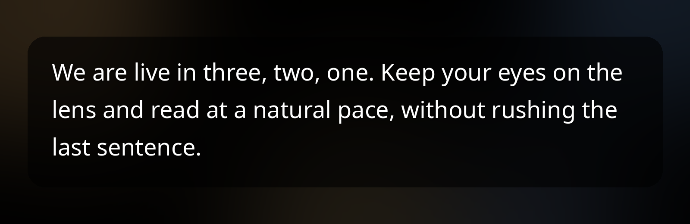

# Teleprompter

Floating teleprompter strip meant to be used **on top of the phone's camera app**.
It does not include its own camera: it draws over the app you are using, usually the
camera, and you record with the one you always use.



Scripts in plain text (`.txt`), no documents, no images, no formatting.

Android only (Android 9 / API 28 or newer). It is a personal project, installed
by building it; it is not published on any app store.

## Download

Grab the latest APK from [Releases](https://github.com/jorgehn98/teleprompter/releases/latest)
and install it on the phone. On first launch the app asks for the "Appear on top"
permission.

## How to use it

1. You open the app and pick a script (or create/import one). On the first
   install a **test script** is added so you can adjust color, size and speed
   without touching your real scripts; if you delete it, it is not created again.
2. You press **Start**. The app asks for the "Appear on top" permission the first
   time.
3. The app goes to the background and the strip keeps floating over the screen.
4. You open your camera, frame the shot, press record and then tap the strip so
   the script starts scrolling.

## Gestures on the strip

| Gesture | What it does |
| --- | --- |
| Short tap | Starts or pauses. The pause stays until you clear it. |
| Drag | Moves the script 1:1 with your finger. On release it returns to the previous state. |
| Double tap | Closes the teleprompter. |

There is no inertia or fling scrolling: the script only moves at the configured
speed or with your finger.

To close it: double tap on the strip, the **Stop** button in the script list or
the **Stop** action in the notification.

## Settings

- Speed (1–10).
- Text size.
- Visible lines (2–8), which also set the height of the strip.
- Text color and background color, with background opacity.
- Position: **top** (default) or **center**.
- Start delay: seconds before the script starts moving after you tap play.

## Build and install

Requires JDK 21 and the Android SDK. The project uses AGP 9 with built-in
Kotlin support; there are no AndroidX or Jetpack Compose dependencies.

```bash
./gradlew :app:assembleDebug
adb install -r app/build/outputs/apk/debug/app-debug.apk
```

`./gradlew :app:assembleRelease` produces a smaller APK signed with the local
debug key, which is fine for installing it on your own phone. You can also copy
the APK to the phone and open it there.

## Permissions

- `SYSTEM_ALERT_WINDOW`: draw the strip over other apps.
- `FOREGROUND_SERVICE` / `FOREGROUND_SERVICE_SPECIAL_USE`: keep the strip alive
  while the camera is in the foreground.
- `POST_NOTIFICATIONS`: the notification with the "Stop" button.

In One UI the overlay permission is called **Appear on top** and is under
Settings → Apps → Special access.

## Known limitations

- **There is no way to know when you press record** in another app, so play is
  manual: you tap the strip. The configurable delay is the closest thing to
  automatic sync.
- The strip only captures taps inside its area; the rest of the screen still
  belongs to the camera. That is why the default position is the top.
- When the phone rotates the strip is rebuilt and keeps the script position.
- Some manufacturers kill overlays aggressively; on Samsung it is worth
  excluding the app from battery optimization if it disappears on its own.

## Structure

```
app/src/main/java/dev/jorgex/teleprompter/
  ScriptListActivity.kt   list, import TXT, rename, delete
  EditorActivity.kt       script editing, saves on exit
  SettingsActivity.kt     strip settings
  ScriptStore.kt          .txt library in files/scripts
  PromptSettings.kt       settings model
  SettingsStore.kt        settings persistence
  PromptLauncher.kt       permission check and startup
  OverlayPermission.kt    "appear on top" permission
  overlay/
    PromptService.kt      foreground service that keeps the strip
    PromptOverlay.kt      floating window and its position
    PromptView.kt         text, scroll and gestures
```

## License

MIT. See [LICENSE](LICENSE).
